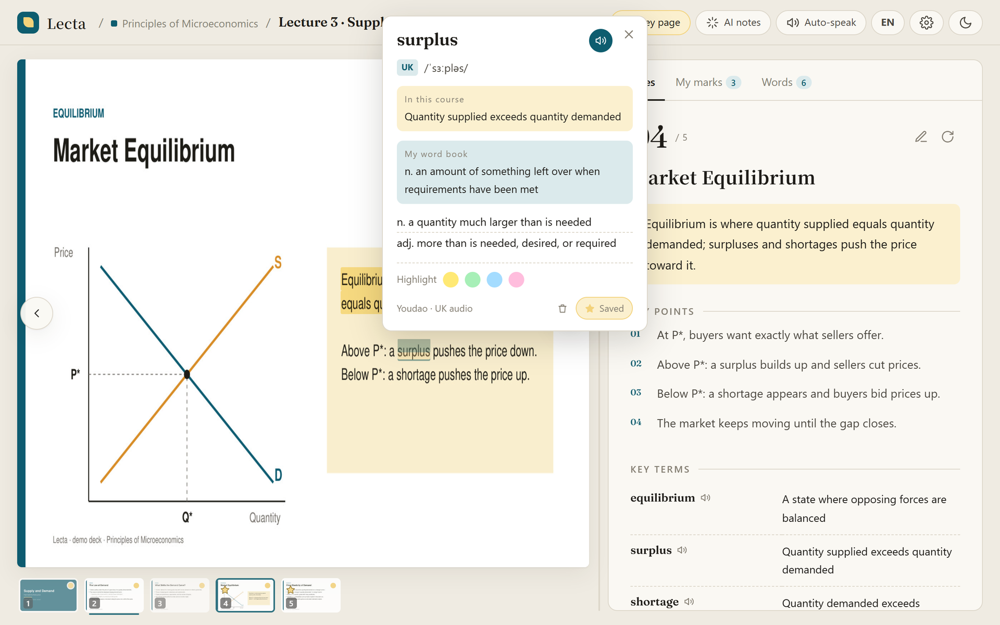
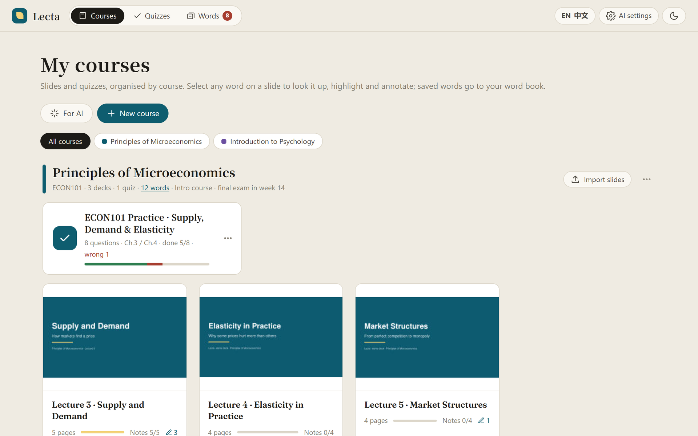
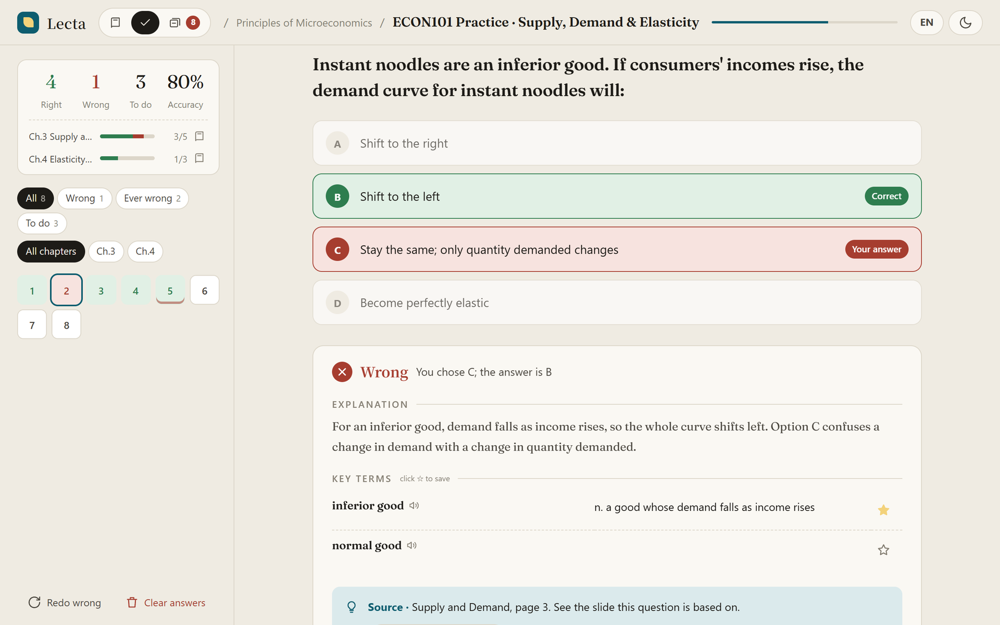
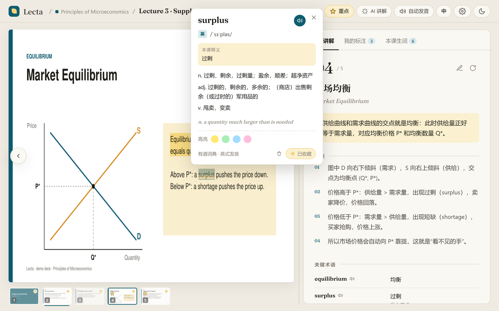

<p align="center">
  
</p>

<p align="center">
  <a href="README.md">English</a> · <a href="README.zh-CN.md">简体中文</a> · <b>Bahasa Melayu</b>
</p>

<p align="center">
  
  
  
  
</p>

> Terjemahan ini disediakan untuk kemudahan. Jika ada percanggahan, rujuk [README dalam bahasa Inggeris](README.md).

**Lecta** menukar slaid kuliah menjadi halaman belajar: slaid di sebelah kiri, nota AI untuk slaid itu di sebelah kanan, dan kamus di bawah setiap perkataan. Import fail `.pptx` atau `.pdf`, kemudian baca, cari makna perkataan, serlahkan teks, berlatih dengan kuiz dan ulang kaji perkataan dengan ulangan berjarak (*spaced repetition*). Semuanya disusun mengikut kursus dan berjalan sepenuhnya di komputer anda sendiri.

Lecta dibina untuk pelajar yang belajar dalam bahasa Inggeris sebagai bahasa kedua. Ia ada dua bahasa pembelajaran: **中文** (nota dan makna dalam bahasa Cina) atau **English** (nota dalam bahasa Inggeris sahaja dan definisi Inggeris–Inggeris).

> Antara muka Lecta kini tersedia dalam bahasa Cina dan Inggeris. Bahasa Melayu ada dalam [pelan](#pelan-pembangunan).

<p align="center">
  
</p>

## Kandungan

- [Ciri-ciri](#ciri-ciri)
- [Tangkapan skrin](#tangkapan-skrin)
- [Mula pantas](#mula-pantas)
- [Menjana nota](#menjana-nota)
- [Bahasa pembelajaran](#bahasa-pembelajaran)
- [Buku perkataan dan ulang kaji](#buku-perkataan-dan-ulang-kaji)
- [Kuiz](#kuiz)
- [Untuk pembantu AI](#untuk-pembantu-ai)
- [Baris arahan](#baris-arahan)
- [Data, privasi dan hak cipta](#data-privasi-dan-hak-cipta)
- [Struktur projek](#struktur-projek)
- [Pembangunan](#pembangunan)
- [Pelan pembangunan](#pelan-pembangunan)
- [Lesen](#lesen)

## Ciri-ciri

| | |
|---|---|
| 📥 **Import slaid** | Seret masuk `.pptx`, `.ppt` atau `.pdf`. Lecta memaparkan setiap halaman, membuat gambar kecil, dan merekod kedudukan tepat setiap perkataan serta nota penceramah. |
| ✨ **Nota AI bagi setiap slaid** | Setiap slaid mendapat kad dengan ringkasan satu ayat, isi penting, istilah utama dan tip peperiksaan. Jana satu halaman, satu julat atau keseluruhan dek, jana semula, atau sunting sendiri. |
| 🔑 **Tidak perlu kunci API** | Gunakan akaun ChatGPT, Claude, Kimi atau DeepSeek yang anda sudah ada: Lecta menulis prompt, anda tampal semula jawapannya, dan ia dipecahkan menjadi nota bagi setiap slaid. Jika [Claude Code](https://claude.com/claude-code) dipasang, nota dijana secara automatik menggunakan langganan Claude anda. Kunci API juga boleh digunakan (Claude, OpenAI dan mana-mana titik akhir serasi OpenAI, termasuk Ollama). |
| 👆 **Klik mana-mana perkataan** | Klik perkataan pada slaid, atau pilih frasa, untuk melihat maknanya, sebutan IPA British dan audio British. Istilah yang ditakrifkan dalam kursus itu sendiri dipaparkan dahulu. Lapisan teks halimunan dijajarkan perkataan demi perkataan, jadi pilihan anda tepat dengan teks asal. |
| 🖍️ **Tanda** | Bintangkan halaman penting, tulis nota halaman (disimpan secara automatik), dan serlahkan teks dalam empat warna dengan komen. |
| 📝 **Kuiz** | Latihan aneka pilihan dengan penerangan, istilah utama dan pautan kembali ke slaid sumber. Tapis mengikut salah, pernah salah atau belum dijawab, dan lihat ketepatan mengikut bab. |
| 📚 **Buku perkataan** | Setiap perkataan yang disimpan mengingati tempat anda menjumpainya: slaid atau soalan mana, dan ayatnya. Cari, tapis mengikut kursus atau tahap, sunting dan eksport ke CSV. |
| 🔁 **Ulang kaji berjarak** | Kad imbas (Space untuk terbalikkan, kekunci 1–4 untuk menilai). Kad yang dilupakan kembali dalam 10 minit; yang diingati dalam 1 → 2 → 4 → 7 → 15 → 30 → 60 hari. |
| 🌏 **中文 / English** | Pilih bahasa pembelajaran semasa pelancaran pertama dan tukar bila-bila masa. Setiap perkataan menyimpan makna Cina dan definisi Inggeris. |
| 🤖 **Boleh dibaca oleh AI** | Fail JSON biasa serta [`AI_GUIDE.md`](AI_GUIDE.md), jadi pembantu AI boleh membaca kursus, nota, kesilapan dan perkataan anda, atau menambah kuiz ke kursus yang betul. |
| 🌙 **Selesa dibaca** | Tukar halaman dengan kekunci anak panah, jalur gambar kecil, panel boleh diubah saiz, mod gelap, dan ia mengingati di mana anda berhenti. |

## Tangkapan skrin

| | |
|---|---|
|  <br> **Kursus.** Dek dan kuiz dikumpulkan mengikut kursus. |  <br> **Kuiz.** Penerangan, istilah utama dan slaid sumber. |
|  <br> **Buku perkataan.** Dari mana setiap perkataan datang, dan sejauh mana anda mengingatinya. |  <br> **Ulang kaji.** Kad imbas ulangan berjarak. |
|  <br> **Mod 中文.** Nota dan makna dalam bahasa Cina. |  <br> **Mod gelap.** |

Semua tangkapan skrin menggunakan kursus demo asli, bukan bahan kuliah sebenar.

## Mula pantas

Anda perlukan **Python 3.10 atau lebih baharu**.

```bash
git clone https://github.com/chenjinxian1/Lecta.git
cd Lecta
```

**Windows:** klik dua kali `启动.bat`. Larian pertama memasang kebergantungan, kemudian pelayar anda membuka <http://127.0.0.1:8770>.

**macOS / Linux:** jalankan `./start.sh`, atau secara manual:

```bash
pip install -r requirements.txt
python -m kejian            # mulakan pelayan dan buka pelayar
```

> Pakej Python dinamakan `kejian`, nama asal projek ini. Semua arahan menggunakan `python -m kejian`.

Pustaka anda bermula dengan **dek contoh** yang lengkap dengan nota (*Supply and Demand*), jadi anda boleh terus mencuba carian perkataan.

### Mengimport fail PowerPoint

PDF boleh diimport terus. `.ppt` dan `.pptx` ditukar kepada PDF terlebih dahulu menggunakan:

- **Windows:** Microsoft PowerPoint, jika dipasang. Persembahan yang sedang dibuka tidak akan diganggu.
- **Sistem lain:** [LibreOffice](https://www.libreoffice.org/).

Jika anda tiada kedua-duanya, eksport ke PDF daripada PowerPoint atau Keynote dan import PDF itu. PDF tidak membawa nota penceramah.

## Menjana nota

Buka **AI settings** di penjuru kanan atas dan pilih satu daripada empat mod:

| Mod | Apa yang diperlukan | Sesuai untuk |
|---|---|---|
| **Sembang web** (lalai) | Mana-mana akaun chatbot: ChatGPT, Claude, Kimi, DeepSeek, Qwen… | Kebanyakan orang, tanpa kunci API |
| **Claude Code** | [Claude Code](https://claude.com/claude-code) dipasang dan log masuk (Claude Pro / Max) | Automatik sepenuhnya tanpa bayaran API |
| **Kunci API** | Kunci daripada penyedia anda | Penjanaan pukal, paling pantas |
| **Rangka luar talian** | Tiada | Rangka sekarang, nota AI kemudian |

### Sembang web: tiga langkah setiap kumpulan

Klik **AI notes** dalam pembaca. Wizard membahagikan dek kepada kumpulan 8 slaid (boleh diubah).

1. **Salin prompt.** Ia sudah mengandungi arahan penulisan, rangka dek, teks dan nota penceramah setiap slaid dalam kumpulan itu, serta format output. Tandakan "I will upload the slide PDF to the AI too" dan lampirkan PDF dalam sembang untuk nota yang lebih baik pada carta.
2. **Tampal ke dalam chatbot.** Mulakan sembang baharu untuk kumpulan pertama dan teruskan dalam sembang yang sama untuk yang lain. Jika jawapan terhenti, taip "continue".
3. **Tampal semula keseluruhan jawapan.** Lecta menunjukkan slaid yang dikenal pasti dan yang tertinggal, kemudian beralih ke kumpulan seterusnya.

### Claude Code: gunakan langganan anda

Jalankan `claude` sekali dalam terminal dan log masuk dengan akaun Claude anda. Kemudian pilih **Claude Code** dalam AI settings dan klik "Test connection". Selepas itu, **AI notes** menjana di latar belakang, dua slaid pada satu masa. Lecta hanya memanggil `claude -p` tempatan anda, membenarkan alat Read (baca sahaja) untuk melihat imej slaid, dan tidak pernah membaca atau menyimpan maklumat log masuk anda.

### Kunci API

| Penyedia | Model lalai | Nota |
|---|---|---|
| Claude (Anthropic) | `claude-opus-5-5` | SDK rasmi dengan output JSON berstruktur; rangka dek dicache, jadi penjanaan pukal lebih murah. |
| OpenAI | `gpt-5` | |
| DeepSeek / Qwen / Kimi | diisi awal | URL asas diisi untuk anda. |
| Ollama | `qwen2.5:14b` | Sepenuhnya tempatan. |
| Rangka luar talian | — | Tanpa AI. Teks slaid disusun menjadi rangka. |

- Kunci disimpan hanya dalam `config.local.json` di komputer anda, yang ada dalam `.gitignore`. Pemboleh ubah persekitaran `ANTHROPIC_API_KEY` dan `OPENAI_API_KEY` juga boleh digunakan.
- "Send slide images to the model" dihidupkan secara lalai, membantu untuk carta dan rajah. Model yang tidak dapat membaca imej akan menggunakan teks sahaja.

## Bahasa pembelajaran

Semasa pelancaran pertama, Lecta bertanya bahasa yang anda mahu gunakan. Tukar bila-bila masa dengan butang **EN / 中文** di pengepala.

| | 中文 | English |
|---|---|---|
| Antara muka | Cina | Inggeris |
| Nota AI | Cina, istilah Inggeris dikekalkan | Inggeris sahaja |
| Kamus | Makna Cina (Youdao) | Definisi Inggeris–Inggeris |
| Buku perkataan dan kad imbas | Makna Cina | Definisi Inggeris |
| Kuiz | Terjemahan Cina jika perlu, penerangan dalam kedua-dua bahasa | Inggeris sahaja |

Setiap perkataan menyimpan kedua-dua makna (`m` untuk Cina, `d` untuk Inggeris), jadi menukar bahasa tidak memerlukan carian baharu.

## Buku perkataan dan ulang kaji

- **Simpan sambil membaca.** Klik ☆ dalam tetingkap kamus, atau di sebelah istilah utama dalam kuiz. Lecta merekod kursus, slaid atau soalan, dan ayat asalnya.
- **Halaman buku perkataan.** Cari, tapis mengikut kursus atau tahap (*New, Learning, Mastered*), sunting makna, definisi dan tag, dan eksport ke CSV.
- **Ulang kaji.** Tekan Space untuk terbalikkan kad, kemudian nilai 1–4 (*Forgot, Hard, Good, Easy*). Selang masa meningkat 1 → 2 → 4 → 7 → 15 → 30 → 60 hari; kad yang dilupakan kembali selepas 10 minit.

## Kuiz

Kuiz berada di dalam kursus. Ada dua cara untuk menambahnya:

- **Daripada PowerPoint**: satu soalan setiap slaid, dengan `Answer: B` dalam nota penceramah.
- **Daripada JSON**: formatnya ada dalam [`AI_GUIDE.md`](AI_GUIDE.md). Minta mana-mana AI menulis soalan daripada nota anda dalam format ini, kemudian import:

```bash
python -m kejian quiz kuiz-saya.json --course econ101 --check   # semak sahaja
python -m kejian quiz kuiz-saya.json --course econ101
```

Jawapan disimpan dalam pustaka, jadi penapis **Wrong** dan **Ever wrong** masih berguna minggu depan.

## Untuk pembantu AI

Pustaka Lecta ialah fail JSON biasa, dan [`AI_GUIDE.md`](AI_GUIDE.md) menerangkan setiap fail. Buka folder ini dengan Claude Code, Codex atau ejen pengekodan lain dan minta, contohnya:

- "Buat kuiz 10 soalan daripada Kuliah 3 dan tambah ke ECON101."
- "Soalan mana yang saya selalu salah? Terangkan konsep di sebaliknya."
- "Jadikan halaman berbintang dan serlahan saya sebagai helaian ulang kaji."

```bash
python -m kejian manifest          # seluruh pustaka sebagai JSON
python -m kejian export <deck-id>  # satu dek sebagai Markdown: teks slaid, nota, tanda anda
python -m kejian export vocab      # buku perkataan sebagai Markdown
```

Menggunakan chatbot dalam pelayar? Butang **For AI** di laman utama menyalin gambaran keseluruhan pustaka atau buku perkataan anda, dan setiap dek atau kuiz ada **Copy for AI** dalam menu ⋯.

## Baris arahan

```bash
python -m kejian                                        # mula (sama seperti: serve)
python -m kejian serve --port 8770 --no-browser
python -m kejian import kuliah3.pptx --title "Kuliah 3" --course econ101
python -m kejian list                                   # kursus → dek / kuiz
python -m kejian course add "Principles of Microeconomics" --code ECON101
python -m kejian course assign econ101 <id-dek-atau-kuiz>
python -m kejian generate <id-dek> --pages 1-10         # hanya halaman tanpa nota
python -m kejian generate <id-dek> --pages all --overwrite
python -m kejian quiz kuiz.json --course econ101
python -m kejian export <id-dek|id-kuiz|vocab> --out nota.md
python -m kejian manifest
python -m kejian check                                  # semak pustaka
```

## Data, privasi dan hak cipta

```
library/
  _courses.json   kursus
  _vocab.json     buku perkataan, termasuk status ulang kaji
  _quizzes/       kuiz
  _progress/      jawapan kuiz
  <id-dek>/
    deck.json     tajuk slaid, teks, nota penceramah, kursus
    words.json    kedudukan setiap perkataan (lapisan teks halimunan)
    notes.json    nota AI setiap slaid; boleh disunting sendiri
    marks.json    bintang, nota halaman dan serlahan anda
    pages/ thumbs/
```

- **Semuanya kekal di komputer anda.** Pelayan hanya mendengar pada `127.0.0.1`. Pindahkan folder `library/` untuk memindahkan data anda, atau tetapkan `KEJIAN_LIBRARY` untuk menyimpannya di tempat lain.
- **Apa yang keluar dari komputer anda:** teks slaid (dan imej slaid, jika dihidupkan) dihantar kepada penyedia AI yang *anda* pilih semasa menjana nota, dan perkataan yang anda cari dihantar ke kamus (Youdao; dalam mod English juga [Free Dictionary API](https://dictionaryapi.dev/)).
- **Hak cipta.** Slaid kuliah biasanya milik pensyarah atau penerbit anda. Import hanya bahan yang anda berhak gunakan, dan **jangan sekali-kali commit `library/` ke repositori awam**. Ia ada dalam `.gitignore` atas sebab ini. Dek contoh dan setiap tangkapan skrin di sini menggunakan kandungan demo asli.

## Struktur projek

```
kejian/
  importer.py    PPTX/PDF → imej halaman, kotak perkataan, nota penceramah
  ai.py          penjanaan nota: Claude API, serasi OpenAI, Claude Code, rangka luar talian
  manual.py      mod sembang web: prompt berkumpulan dan menghurai jawapan yang ditampal
  jobs.py        tugas latar belakang (import, penjanaan pukal) dan kemajuan
  server.py      pelayan HTTP tempatan dan API JSON
  library.py     baca/tulis pustaka
  userdata.py    kursus, buku perkataan (ulangan berjarak), tanda, kemajuan kuiz
  quiz.py        kuiz: import PPT / JSON, pengesahan, eksport
  manifest.py    gambaran keseluruhan untuk AI, eksport Markdown, semakan kendiri
  dictionary.py  proksi kamus (pelayar tidak dapat memanggilnya terus kerana CORS)
  web/           frontend: JavaScript biasa, tiada langkah build
examples/        dek contoh
scripts/         skrip yang membina dek contoh
tests/           ujian unit
docs/images/     imej README
```

## Pembangunan

```bash
python -m unittest discover -s tests -v
KEJIAN_DEBUG=1 python -m kejian serve --no-browser    # log permintaan
```

Backend ialah pustaka standard Python serta PyMuPDF; frontend ialah JavaScript biasa dalam `kejian/web/`. Sunting dan muat semula, tiada build diperlukan. Ejen pengekodan AI patut membaca [`AGENTS.md`](AGENTS.md) dahulu.

Isu dan *pull request* dialu-alukan.

## Pelan pembangunan

- [ ] Eksport dek bersama nota sebagai PDF
- [ ] Eksport buku perkataan ke Anki
- [ ] OCR untuk PDF yang diimbas
- [ ] Lebih banyak bahasa pembelajaran, termasuk antara muka Bahasa Melayu

## Lesen

[MIT](LICENSE) © Lecta contributors
