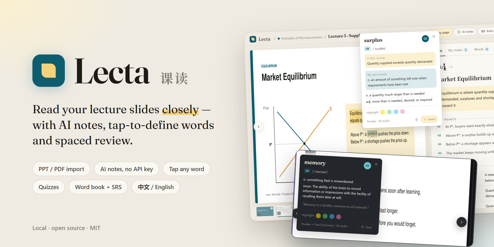
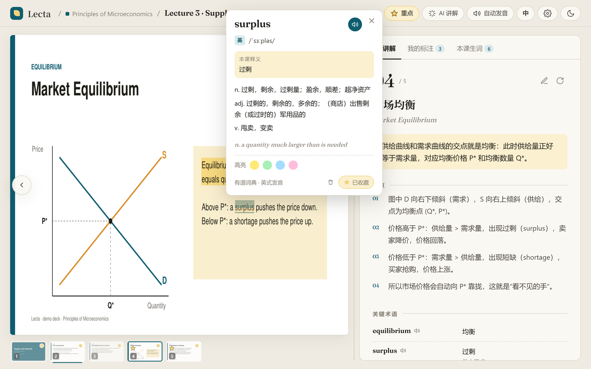
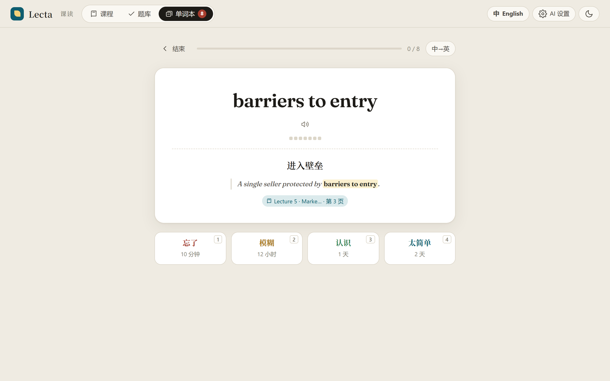
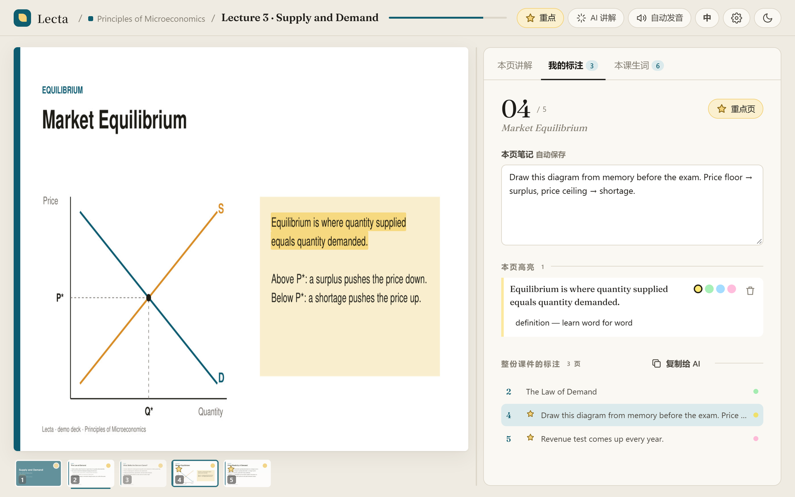
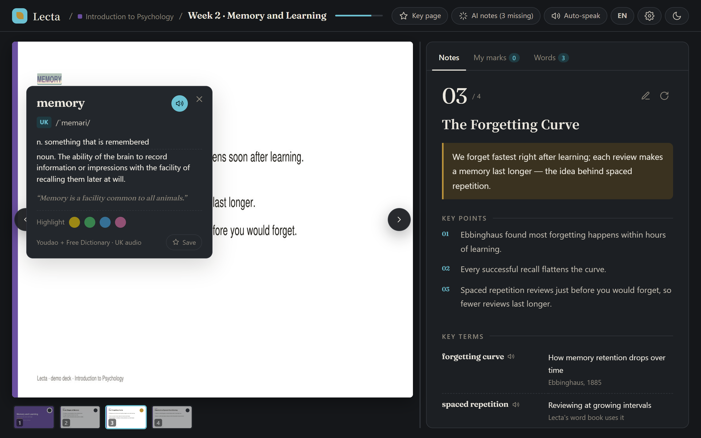
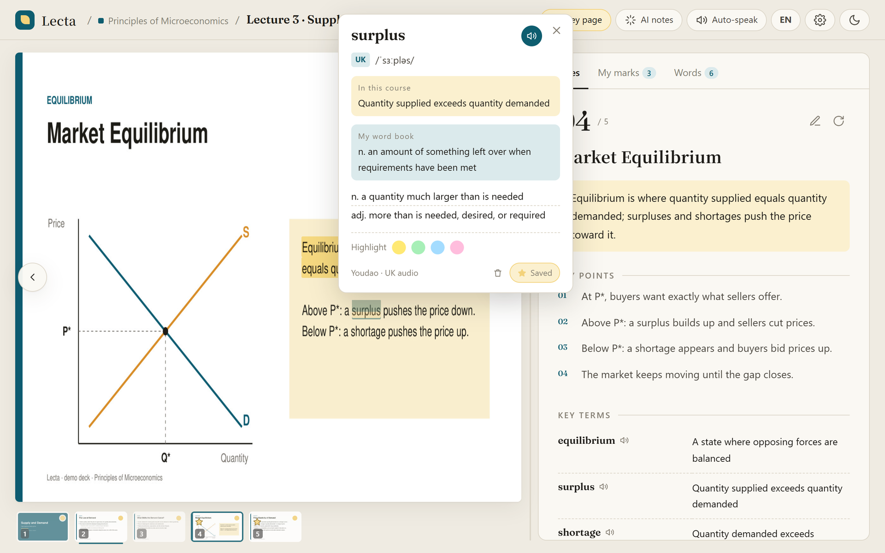

<p align="center">
  
</p>

<p align="center">
  <a href="README.md">English</a> · <b>简体中文</b> · <a href="README.ms.md">Bahasa Melayu</a>
</p>

<p align="center">
  
  
  
  
</p>

**Lecta 课读**把英文课件变成精读页面：左边看 PPT，右边看 AI 为这一页写的讲解，课件上每个单词点一下就能查。导入 `.pptx` / `.pdf` 之后，可以边读边查词、高亮批注、刷题，再用间隔复习把生词背下来。按课程整理，所有东西都在你自己的电脑上运行。

它是为用英语上课的中文学生做的，所以有两种学习语言：**中文**（中文讲解、中文释义）和 **English**（全英文讲解、英英释义），第一次打开时选，之后随时切换。

<p align="center">
  
</p>

## 目录

- [功能](#功能)
- [截图](#截图)
- [快速开始](#快速开始)
- [讲解怎么生成](#讲解怎么生成)
- [学习语言](#学习语言)
- [单词本与背单词](#单词本与背单词)
- [题库](#题库)
- [给 AI 助手用](#给-ai-助手用)
- [命令行](#命令行)
- [数据、隐私与版权](#数据隐私与版权)
- [项目结构](#项目结构)
- [开发](#开发)
- [计划](#计划)
- [License](#license)

## 功能

| | |
|---|---|
| 📥 **导入课件** | 拖入 `.pptx` / `.ppt` / `.pdf` 即可。自动生成高清页面和缩略图，并记下每个单词的精确位置和演讲者备注。 |
| ✨ **逐页 AI 讲解** | 每页一张讲解卡片：一句话核心、要点、关键术语、考点提示。可以逐页、按范围或整份生成，也能重新生成或手动编辑。 |
| 🔑 **不用 API Key** | 用你已有的 ChatGPT / Claude / Kimi / DeepSeek 网页版账号：程序把课件整理成提示词，复制过去，再把回复粘贴回来，就自动拆成每页讲解。装了 [Claude Code](https://claude.com/claude-code) 的话，可以用 Claude 订阅全自动生成。也支持 API Key（Claude、OpenAI 以及所有 OpenAI 兼容接口，包括 Ollama）。 |
| 👆 **点词就查** | 在课件上单击一个词或划选一个短语，弹出释义、英式音标和英式真人发音。课件里定义过的术语，优先显示“本课释义”。透明文字层按单词逐个对齐，选区和原文严丝合缝。 |
| 🖍️ **标注** | 标 ★ 重点页、写页面笔记（自动保存）、四色高亮原文并加批注；缩略图上能看到哪些页有标注。 |
| 📝 **题库** | 选择题练习，带解析、关键术语和“跳回课件原页”。可以按“错题”“曾错”“未做”筛选，按章节看正确率。 |
| 📚 **单词本** | 收藏时自动记下出处（哪一页课件 / 哪道题）和原句。可以搜索、按课程或熟练度筛选、编辑、导出 CSV。 |
| 🔁 **背单词** | 闪卡复习（空格翻面，1–4 打分）。忘了的 10 分钟后再见，记住的间隔 1 → 2 → 4 → 7 → 15 → 30 → 60 天。 |
| 🌏 **中文 / English** | 每个词同时存中文释义和英文释义，切换语言不用重查。 |
| 🤖 **AI 读得懂** | 课件库是普通 JSON 文件，[`AI_GUIDE.md`](AI_GUIDE.md) 写清了结构，AI 助手可以直接读你的课程、讲解、错题和生词，也能把新题库放进对应课程。 |
| 🌙 **阅读体验** | 方向键翻页、缩略图导航、可拖动分栏、深色模式、记住阅读进度。 |

## 截图

| | |
|---|---|
|  <br> **课程首页**：课件和题库按课程分组，进度一目了然。 |  <br> **题库**：中文对照、中英解析、关键术语、跳回原页。 |
|  <br> **单词本**：每个词从哪来、记得怎么样。 |  <br> **背单词**：按遗忘曲线安排复习。 |
|  <br> **我的标注**：重点页、笔记和高亮。 |  <br> **深色模式**（English 模式）。 |
|  <br> **English 模式**：英文讲解、英英释义。 |  <br> **第一次打开**：选择学习语言。 |

截图里都是原创的演示课程，不含任何真实课件。

## 快速开始

需要 **Python 3.10 或更高版本**。

```bash
git clone https://github.com/chenjinxian1/Lecta.git
cd Lecta
```

**Windows**：双击 `启动.bat`。第一次会自动安装依赖，然后浏览器打开 <http://127.0.0.1:8770>。

**macOS / Linux**：运行 `./start.sh`，或者手动：

```bash
pip install -r requirements.txt
python -m kejian            # 启动并自动打开浏览器
```

> Python 包名是 `kejian`（项目最初的名字），所有命令都是 `python -m kejian`。

课件库里自带一份讲解齐全的**示例课件**（Supply and Demand），打开就能试着点词。

### 导入 PPT 需要什么？

PDF 可以直接导入。`.ppt` / `.pptx` 要先转成 PDF，程序会自动调用：

- **Windows**：已安装的 Microsoft PowerPoint（不会关闭你正在打开的演示文稿）
- **其它系统**：[LibreOffice](https://www.libreoffice.org/)

两者都没有的话，在 PowerPoint / Keynote 里“导出为 PDF”再导入即可（PDF 不带演讲者备注）。

## 讲解怎么生成

点右上角 **AI 设置**，四种方式任选：

| 方式 | 需要什么 | 适合 |
|---|---|---|
| **网页版 AI**（默认） | 任意网页版 AI 账号：ChatGPT、Claude、Kimi、DeepSeek、豆包、通义… | 大多数人，没有 API Key |
| **Claude Code** | 本机装好并登录 [Claude Code](https://claude.com/claude-code)（Claude Pro / Max 订阅） | 想全自动、又不想单独付 API 费用 |
| **API Key** | 各家的 API Key | 批量生成、最快 |
| **离线提纲** | 什么都不要 | 先有个提纲，以后再用 AI 重写 |

### 网页版 AI：每组三步

在阅读页点 **AI 讲解**，向导会把课件按每组 8 页（可调）分好：

1. **复制提示词**：里面已经有写作要求、整份课件目录、这一组每页的文字和演讲者备注，以及输出格式。勾选“我会把课件 PDF 一起上传给 AI”，再把 PDF 拖进对话框，图表页会讲得更准。
2. **在 AI 网页里粘贴发送**：第一组新开对话，后面几组在同一个对话里接着发。回复中途停了就说“继续”。
3. **把完整回复粘贴回来**：程序实时显示认出了哪几页、缺哪几页，保存后自动跳到下一组。回复被截断、几段回复拼在一起、页码写法不同都能识别。

### Claude Code：用订阅自动生成

先在终端运行一次 `claude`，用你的 Claude 账号登录。然后在 AI 设置里选 **Claude Code**，点“测试连接”。之后点 **AI 讲解** 就会在后台批量生成（同时 2 页）。程序只调用你本机的 `claude -p`，只开放只读的 Read 工具来看幻灯片图片，不会读取或保存你的登录凭据。

### API Key

| 服务商 | 默认模型 | 说明 |
|---|---|---|
| Claude (Anthropic) | `claude-opus-5-5` | 官方 SDK，结构化 JSON 输出；课件目录作为缓存前缀，批量生成更省钱 |
| OpenAI | `gpt-5` | |
| DeepSeek / 通义千问 / Kimi | 预填 | 选中后自动填好 Base URL |
| Ollama | `qwen2.5:14b` | 完全本地运行 |
| 离线提纲 | — | 不调用 AI，把页面文字整理成提纲 |

- API Key 只保存在本机的 `config.local.json`（已加入 `.gitignore`）。也可以用环境变量 `ANTHROPIC_API_KEY` / `OPENAI_API_KEY`。
- “把幻灯片图片一起发给模型”默认开启，图表、流程图页讲得更准；模型不支持看图时自动退回纯文字。

## 学习语言

第一次打开时选择学习语言，之后用顶栏的 **中 / EN** 按钮随时切换。

| | 中文 | English |
|---|---|---|
| 界面 | 中文 | 英文 |
| AI 讲解 | 中文，保留英文术语 | 全英文 |
| 查词 | 中文释义（有道词典） | 英英释义 |
| 单词本、闪卡 | 中文释义 | 英文释义 |
| 题库 | 可开“中文对照”，中英解析 | 只显示英文 |

单词本里每个词同时存中文释义（`m`）和英文释义（`d`），切换语言不用重查。如果某份课件的讲解是另一种语言，阅读页会提示你一键重新生成。

## 单词本与背单词

- **边读边收藏**：在查词弹窗里点 ☆，或在题目的关键术语旁点 ☆。程序记下课程、出处（课件页或题号）和原句。
- **单词本页面**：搜索，按课程或熟练度（新词、学习中、已掌握）筛选，编辑释义和标签，导出 CSV。缺释义的词可以用“补全中文释义”（English 模式下是补全英文释义）一次补齐。
- **背单词**：空格翻面，按 1–4 打分（忘了 / 模糊 / 认识 / 太简单）。间隔 1 → 2 → 4 → 7 → 15 → 30 → 60 天递增；忘了的 10 分钟后再出现。

## 题库

题库挂在课程下，有两种导入方式：

- **从 PPT**：一页一道题，演讲者备注里写 `Answer: B`。
- **从 JSON**：格式见 [`AI_GUIDE.md`](AI_GUIDE.md)。可以让任意 AI 按这个格式根据你的课件出题，再导入：

```bash
python -m kejian quiz 题库.json --course econ101 --check   # 只校验
python -m kejian quiz 题库.json --course econ101
```

每道题可以带中文翻译、中英解析、关键术语和对应的课件页。做题记录保存在课件库里，下周再来，“错题”“曾错”筛选照样有用。

## 给 AI 助手用

课件库是普通 JSON 文件，[`AI_GUIDE.md`](AI_GUIDE.md) 写清了每个文件。用 Claude Code、Codex 等 AI 助手打开这个文件夹，就可以直接说：

- “根据第 3 讲出 10 道选择题，放进 ECON101。”
- “我老是错哪些题？把背后的概念讲一遍。”
- “把我标了重点和高亮的内容整理成复习提纲。”

常用命令：

```bash
python -m kejian manifest          # 整个课件库（JSON）：课程、课件、题库、进度
python -m kejian export <课件ID>    # 单份课件（Markdown）：原文、讲解、我的标注
python -m kejian export vocab      # 单词本（Markdown）
```

用网页版 AI？首页的 **给 AI 用** 按钮可以复制课件库总览或单词本；单份课件、题库在“⋯”菜单里点 **复制给 AI**。

## 命令行

```bash
python -m kejian                                        # 启动（等同于 serve）
python -m kejian serve --port 8770 --no-browser
python -m kejian import 第三讲.pptx --title "第三讲" --course econ101
python -m kejian list                                   # 课程 → 课件 / 题库
python -m kejian course add "微观经济学" --code ECON101
python -m kejian course assign econ101 <课件或题库ID>
python -m kejian generate <课件ID> --pages 1-10         # 只生成缺讲解的页
python -m kejian generate <课件ID> --pages all --overwrite
python -m kejian quiz 题库.json --course econ101
python -m kejian export <课件ID|题库ID|vocab> --out notes.md
python -m kejian manifest
python -m kejian check                                  # 自检课件库
```

## 数据、隐私与版权

```
library/
  _courses.json   课程
  _vocab.json     单词本（含复习进度）
  _quizzes/       题库
  _progress/      做题记录
  <课件ID>/
    deck.json     每页标题、正文、演讲者备注、所属课程
    words.json    每个单词的坐标（透明文字层）
    notes.json    每页讲解，可以直接手改
    marks.json    我的标注（重点页、笔记、高亮）
    pages/ thumbs/
```

- **数据都在你自己的电脑上**。程序只监听 `127.0.0.1`。换电脑时把 `library/` 整个拷走即可；用环境变量 `KEJIAN_LIBRARY` 可以把课件库放到别处。
- **哪些内容会发出去**：生成讲解时，页面文字（开启时还有页面图片）会发给*你选择的* AI 服务商；查词时，所查的单词会发给词典（有道；English 模式还会用 [Free Dictionary API](https://dictionaryapi.dev/)）。
- **版权**：课件通常属于老师或出版社。请只导入你有权使用的材料，**不要把 `library/` 提交到公开仓库**（它已经在 `.gitignore` 里）。仓库自带的示例课件和所有截图都是原创演示内容。

## 项目结构

```
kejian/
  importer.py    PPTX/PDF → 页面图 + 单词坐标 + 备注（PowerPoint / LibreOffice + PyMuPDF）
  ai.py          讲解生成：Claude API / OpenAI 兼容 / Claude Code / 离线提纲
  manual.py      网页版模式：分组提示词、解析粘贴回来的回复
  jobs.py        后台任务（导入、批量生成）与进度
  server.py      本地 HTTP 服务与 JSON API
  library.py     课件库读写
  userdata.py    课程、单词本（间隔复习）、标注、做题进度
  quiz.py        题库：PPT / JSON 导入、校验、导出
  manifest.py    给 AI 的总览、Markdown 导出、自检
  dictionary.py  词典代理（浏览器直连会被跨域拦截）
  web/           前端（原生 JS，无需构建）
examples/        示例课件
scripts/         生成示例课件的脚本
tests/           单元测试
docs/images/     README 用图
```

## 开发

```bash
python -m unittest discover -s tests -v
KEJIAN_DEBUG=1 python -m kejian serve --no-browser    # 打印请求日志
```

后端是 Python 标准库 + PyMuPDF，前端是 `kejian/web/` 下的原生 JavaScript，改完刷新即可，不用构建。AI 编程助手请先读 [`AGENTS.md`](AGENTS.md)。

欢迎提 Issue 和 PR。

## 计划

- [ ] 导出带讲解的 PDF
- [ ] 单词本导出到 Anki
- [ ] 扫描版 PDF 的 OCR
- [ ] 更多学习语言

## License

[MIT](LICENSE) © Lecta contributors
